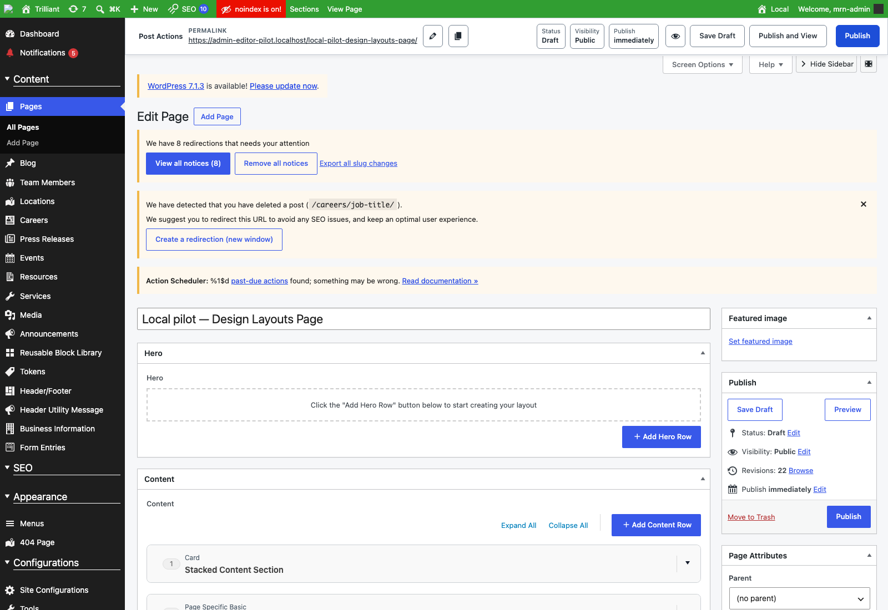
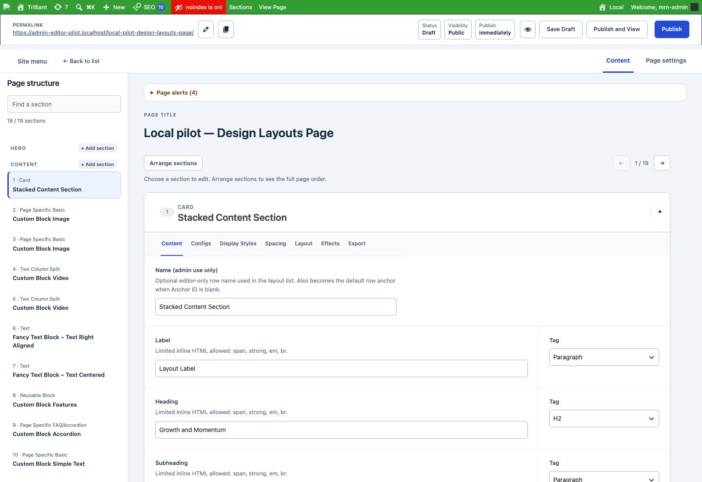

# Local editor workspace revision

The first W0–W4 pilot passed technical checks but failed actual MRN editor review: it did not feel substantially different from WordPress. This revision changes the workspace and editing workflow. It is a **local candidate for another editor review**, not accepted UX, broad compatibility qualification or a Fleet release.

## What was wrong

The previous pilot left the WordPress sidebar, two-column metabox hierarchy, empty builder regions, notices and page metadata competing with content. The outline was closed on arrival and overlaid the existing screen. Better summaries reduced searching, but the editor still faced an endless stack of layouts. The original scripted jump measurements did not establish that the editing experience was better.

The fresh before screenshot at 1600 × 1100 shows the consequence: alerts, title, an empty Hero region and publishing metadata fill the opening screen. The first meaningful content section appears near the bottom, collapsed. Navigation improvements were largely invisible until invoked.

## What materially changed

- **A content workspace on arrival.** The site-wide menu yields to a persistent Page structure rail. The original menu is available through Site menu, with Back to list alongside it. This changes only the local editor view, without changing stored WordPress menu preferences.
- **A manageable working set.** One native root ACF section opens at a time. Selecting an outline item replaces the working section in place. Previous/next, section position, search and return navigation support long pages. The selected section is remembered for the same page in the same browser tab, including save/reload.
- **An explicit ordering workflow.** Arrange sections reveals the original native ACF layouts and handles across Hero, Content and After Content. Adding delegates to the existing picker, and appended/duplicated content becomes the selected section. The original fields and ordering stay inside their original form.
- **Content and Page settings have distinct views.** Featured image, attributes, author, imports, slug, revisions, SEO and other native metaboxes are available in Page settings. The existing publishing toolbar stays available. Native section tabs still own each section's content and design fields.
- **Page alerts stop displacing the editing task.** Original visible notices are placed in a disclosure with their original links, buttons and events. Errors and saved-state messages open it automatically. Live connection/validation notices remain native. No actionable notice is flattened into text.
- **A coherent light workspace.** A broad canvas, prominent editable page title, readable section heading, consistent surface spacing and selected-section treatment support the new hierarchy. At narrow widths the outline becomes an explicit drawer and native section actions wrap under the heading.

Additional views: [Page settings](evidence/after-settings.png), [Arrange sections](evidence/after-arrange.png), [validation recovery](evidence/after-validation.png), [mobile](evidence/after-mobile.png), [reflow](evidence/after-reflow.png), and [full-height focused page](evidence/after-workspace-full.png). The opening screenshots include the full workspace chrome, outline, publishing actions and editing canvas; they are not cropped component examples.

## Local demonstration

Select **admin-editor-pilot** in Local Hub and use **Login to Admin**, then open the [19-section real page copy](https://admin-editor-pilot.localhost/wp-admin/post.php?post=2523&action=edit). It is a draft copy of Trilliant's Design Layouts Page from the existing local snapshot. The [32-section derived fixture](https://admin-editor-pilot.localhost/wp-admin/post.php?post=2524&action=edit) repeats existing sections for stress checks.

Start with the first section, search for **More From**, then edit a section's native fields. Switch to Page settings and back; use Arrange sections to inspect order. Save Draft, reload and confirm the same selected section returns. Evaluate whether these tasks now feel substantially clearer and faster. A fresh browser tab starts at the first section; same-tab selection is restored.

The fixture remains isolated: local hostname only, external WordPress HTTP requests blocked, cron disabled and outgoing mail suppressed. No media upload, deletion or replacement was performed. The existing uploads symlink was preserved. No shared development, staging or production environment was changed.

## Native integrity and scope

The single strict `MRN_EDITOR_EXPERIENCE_ENABLED` flag and `.localhost` hostname gate remain. **Emergency disable:** set that flag to `false` in this fixture's `public/wp-config.php`, wait for the local PHP configuration cache to revalidate (3 seconds used in the check), and reload. No stored ACF data migration or cleanup is needed. If the workspace script cannot load, its scoped layout classes are not mounted and native editing remains available.

Inactive sections and page metaboxes are parked with presentation classes. They are never moved, disabled, cloned into a second editor or removed from the form. No ACF field keys, names, conditional logic, storage schema, save endpoint or publishing handler changed. Native ACF owns expansion, field tabs, append, duplicate, remove, sort, validation, TinyMCE and serialization. The small same-tab selection record contains only post ID, field key and index; it is not content or an ordering store.

One demonstrated conflict required a narrow exception: Editor Lockdown's legacy sidebar restore injected fixed sidebar widths and competing Hide Sidebar/distraction controls. Its initialization is skipped only on the enabled pilot screen; existing metabox locking, loading feedback and all other screens retain their behavior. No provider registry or ownership contract was introduced.

## Validation and measurement

The local revision is implemented and ready for UX review. **Release qualification remains open** for startup costs and a console event described below. Evidence is retained with this candidate; component QA success is not editor acceptance or release signoff.

The authenticated workflow checks native form entries across workspace modes, section context, add/duplicate/remove/sort, native media, server validation, TinyMCE and nested repeater edits, Save Draft/reload, the existing HTTP 400 truncated-save protection and the 32-section fixture. New workspace surfaces are scanned with MRN QA Engine's installed Playwright/axe dependencies. Native ACF/TinyMCE findings are separately compared with the prior pilot on the same expanded section.

The [final navigation run](evidence/navigation-final.json) passes, including a deliberately inserted late notice, the complete opening workspace, keyboard selection, context restoration, native operations/media, server validation and mobile/reflow. Desktop and mobile scans of new controls report zero violations. [Emergency disable](evidence/disable-results.json), [blocked-script fallback](evidence/fallback-results.json) and [native conditional logic](evidence/conditional-results.json) also pass.

The full save run completed its functional assertions (TinyMCE and nested FAQ edits across parked sections, native Save Draft/reload/restoration, 32-section save and truncated submission rejection). Its final strict zero-console-error assertion **failed** on one `Transition was skipped` event. The origin was not captured; this is an unresolved compatibility observation, not a clean overall pass. The [run status](evidence/full-run-status.json) and [original error](evidence/workflow-console-event.log) retain that result. The subsequent final navigation run has no page errors. No product code suppresses that event.

[Final readback](evidence/final-content-readback.json) and [hash comparison](evidence/save-integrity-comparison.json) prove both fixtures retain their baseline raw ACF hashes, main content hashes, post content, draft status and all 19/32 rows. Test edits are restored. The MRN QA Engine [Editor Lockdown](evidence/qa-editor.md) and [Admin UI CSS](evidence/qa-styles.md) component suites pass; they are standard component checks, not release signoff.

The standard MRN QA component profiles intentionally skip generic public-page browser, accessibility, performance and CWV rows: those do not exercise this authenticated editor. The authenticated harness and paired browser measurements provide the applicable runtime evidence. API surface checks are not applicable because no endpoint changed; the local REST index is checked. Remote parity, Fleet, packaging, deployment, license and broad plugin/theme/role/version compatibility suites are intentionally outside this review. The staged-snapshot commit gate passed; its report is retained in `outputs/admin-editor-pilot/revision/qa-commit.md`. It has a PHPStan advisory because the isolated snapshot lacks WP CLI stubs; the separate full component PHPStan rows pass. This gate proves the staged source snapshot, not release/runtime clearance.

Known native findings in the first expanded section are identical before and after: 72 button-name, 16 color-contrast and 75 nested-interactive nodes. These involve existing TinyMCE toolbars and native ACF controls. They were not patched by rewriting native widgets. The new workspace scan is separate; this is not a claim that the entire WordPress editor meets WCAG AA.

A native-save rerun exposed a browser harness redirect/reload race. Persisted data was read back before another write. Recovery restored only three known test values, with a guard requiring the reconstructed full content hash to equal the recorded baseline. Navigation is now awaited from before the save trigger, and no automatic retry of an uncertain POST is used.

## Measured experience and startup cost

At 1600 × 1100, the final opening view shows one expanded section, the persistent outline and the first editable field at **680 px** from the viewport top. The prior pilot opened with 19 collapsed root sections and a closed outline. The final scripted search/Enter selection took **70.9 ms**. This measures UI response after a supplied query, not a human completion time. Actual MRN editor task times and acceptance remain pending.

Three alternating before/after pairs were measured per page, with external browser requests blocked. Before uses the original pilot JS/CSS from `0fe8847c`; both variants use the same current local PHP runtime. This isolates the browser workspace rather than comparing unrelated backend versions. Values below are medians; raw samples and asset hashes are in [measurements](evidence/measurements.json).

| Fixture | Load before → revision | Client response-end → DOM ready | Reported JS heap before → revision |
| --- | --- | --- | --- |
| 19 sections | 6.38 → 5.23 s | 444 → 414 ms | 33.5 → 40.1 MB |
| 32 sections | 4.74 → 3.56 s | 831 → 497 ms | 35.6 → 45.2 MB |

Both variants were also sampled with the same native first section expanded (three native TinyMCE containers). Cumulative long-task time was **531 → 784 ms** on the real page and **848 → 817 ms** on the stress fixture. Reported heap remained higher in the revision. Chromium's heap estimate and these small local samples are diagnostic, not a memory-leak determination or evidence of general speed improvement. The server/document request varied materially during the work. **Performance is not cleared for release**; the extra startup work/resource use must be bounded or addressed before qualification.

The two existing assets total 38,751 source bytes, approximately 9,417 gzip bytes, versus 18,165 / 5,255 before ([asset sizes](evidence/asset-sizes.json)). No additional bundle, library, request API or framework was introduced. Native fields remain in memory and serialize even while parked. A very dense individual section still has a long native form; this revision reduces the active root-section working set, not the stored controls.

## Changed files and components

Revision candidate versions: **Editor Lockdown 1.0.36** and **Admin UI CSS 3.2.6**. Dashboard Support's existing pilot notice behavior is reused without another change. Universal Sticky Bar, Config Helper, theme rendering, ACF definitions and frontend output are unchanged.

Product files:

- `mu-plugins/mrn-editor-lockdown/assets/section-navigator.js`
- `mu-plugins/mrn-editor-lockdown/includes/section-navigator.php`
- `mu-plugins/mrn-editor-lockdown/mrn-editor-lockdown.php`
- `mu-plugins/mrn-admin-ui-css/mrn-editor-workspace.css`
- `mu-plugins/mrn-admin-ui-css/mrn-admin-ui-css.php` (candidate version only)
- Both components' `README.md` and `stack.lock` metadata.

Test/evidence files:

- `mu-plugins/mrn-editor-lockdown/tests/runtime/editor-workspace-browser.cjs`
- `mu-plugins/mrn-editor-lockdown/tests/runtime/editor-workspace-measure.cjs`
- `mu-plugins/mrn-editor-lockdown/tests/runtime/editor-workspace-fallback.cjs`
- `mu-plugins/mrn-editor-lockdown/tests/runtime/section-navigator-fixture.php` (guarded recovery for an interrupted local test)
- `docs/admin-editor-pilot/README.md` (marks the first report historical)
- This report and its `evidence/` files.

All work stays on `codex/admin-editor-pilot-20261029` in the dedicated worktree. It is a local review candidate; no push, merge, Fleet publication or deployment is part of this revision.

## Recommendation

Have an MRN editor review this complete workspace before approving another implementation sprint. Evaluate the opening screen, editing content in several distant sections, finding page options, rearranging sections and returning after Save Draft. Collect actual editor task times and qualitative friction; scripted navigation latency does not establish human usability improvement.

If the revised direction is accepted, separately approve the next bounded compatibility/accessibility/performance scope. Existing native-widget findings and the cost of initializing the first section should remain visible in that decision. **W5–W7 and broad administration restyling have not begun.**
